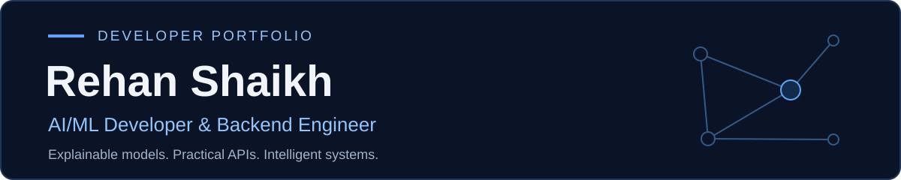

  

  
<strong>4× hackathon podium finishes</strong> · <strong>CSI Technical Team, KKWIEER</strong>

  

    <a href="#selected-projects">Projects</a> ·
    <a href="#engineering-evidence">Architecture &amp; code</a> ·
    <a href="#achievements">Achievements</a> ·
    <a href="https://www.linkedin.com/in/rehan-shaikh113/">LinkedIn</a> ·
    <a href="mailto:rehanshaikh30307@gmail.com">Email</a>
  

---

## About

I'm **Rehan Shaikh**, a Computer Engineering student at **KKWIEER, Nashik**. I build explainable ML workflows, backend APIs, and applications that turn complex data into useful decisions.

My interests span **fraud detection, graph intelligence, RAG evaluation, and intelligent automation**. I also contribute as a **Technical Team Member at the CSI student branch**.

## Selected projects

### 01 · UniGraph — Fraud detection & graph intelligence

**1st place, MIT ADT AI Grand Challenge 2026 · ₹1,00,000 prize**

My hackathon work focused on transaction graphs and explainable fraud detection. The public React/TypeScript prototype demonstrates alert triage, fraud-pattern investigation, and graph-based risk explanations using scenario data.

**Public stack:** React · TypeScript · Vite · Recharts

[Interface repository](https://github.com/rehan-03/UniGraph) · [Graph investigation code](https://github.com/rehan-03/UniGraph/blob/main/src/pages/GraphExplorer.tsx) · [Local setup](https://github.com/rehan-03/UniGraph/blob/main/README.md)

**Related blockchain backend:** [sih-backend](https://github.com/rehan-03/sih-backend) is a separate FastAPI project with BTC/ETH/TRON tracing, XGBoost risk scoring, SHAP explanations, Neo4j graph storage, and Celery workers. Explore the [API contract](https://github.com/rehan-03/sih-backend/blob/main/contracts/openapi.yaml), [model evaluation and limitations](https://github.com/rehan-03/sih-backend/blob/main/docs/ml.md), or a [guided local investigation demo using synthetic data](https://github.com/rehan-03/NCRP-demo/blob/main/README.md).

### 02 · RAGShield — Evaluation for reliable RAG agents

An OpenEnv-compatible reinforcement learning environment for reviewing generated answers across financial, medical, and legal scenarios. Agents select evidence, verify claims, rewrite answers, and decide whether to approve, reject, or escalate.

**Engineering focus:** seeded synthetic episodes, action budgets, dense rewards, pluggable RAG providers, and HTTP/WebSocket interfaces.

**Stack:** Python · FastAPI · OpenEnv · Reinforcement Learning

[Repository](https://github.com/rehan-03/ragshield) · [Environment implementation](https://github.com/rehan-03/ragshield/blob/main/server/environment.py) · [Local demo & setup](https://github.com/rehan-03/ragshield/blob/main/README.md#quick-start) · [Smoke checks](https://github.com/rehan-03/ragshield/blob/main/test_smoke.py)

### 03 · AlgoLearn — Adaptive learning & code evaluation

A learning platform combining algorithm visualizations, adaptive quizzes, and automated evaluation of C, C++, Java, and Python submissions.

**Engineering focus:** difficulty adapts to answer correctness; progress tracks weak concepts; role-based APIs separate student and faculty access. Judge0 submissions use bounded concurrency, timeouts, and Redis-backed rate limiting.

**Stack:** Next.js · React · Node.js · Express · MongoDB · Redis · Judge0

[Repository](https://github.com/rehan-03/PBL) · [Adaptive assessment](https://github.com/rehan-03/PBL/blob/main/backend/src/modules/assessment/assessment.service.js) · [Code execution service](https://github.com/rehan-03/PBL/blob/main/backend/src/modules/code/code.service.js) · [Local demo & setup](https://github.com/rehan-03/PBL/blob/main/README.md#quick-start)

## Engineering evidence

| System | Architecture to explore | Reviewable implementation |
| :--- | :--- | :--- |
| Blockchain backend | Explorer data → FastAPI services → wallet records and risk explanations; Celery builds the transaction graph in Neo4j. | [Tracing](https://github.com/rehan-03/sih-backend/blob/main/backend/app/services/tracing_service.py) · [Graph worker](https://github.com/rehan-03/sih-backend/blob/main/backend/app/workers/tasks/graph_builder.py) |
| RAGShield | Seeded scenario → agent actions → reward and grader feedback → review decision. | [Environment](https://github.com/rehan-03/ragshield/blob/main/server/environment.py) · [Rewards](https://github.com/rehan-03/ragshield/blob/main/server/rewards.py) |
| AlgoLearn | Next.js interface → Express API → MongoDB progress data; Redis limits Judge0 code submissions. | [Code service](https://github.com/rehan-03/PBL/blob/main/backend/src/modules/code/code.service.js) · [Access control](https://github.com/rehan-03/PBL/blob/main/backend/src/middleware/auth.js) |

**More intelligent automation:** I worked on the [DPR Evaluation & Assessment Platform](https://github.com/xemorph64/DPR_new), which combines OCR, semantic retrieval, and compliance analysis for project reports. [Architecture](https://github.com/xemorph64/DPR_new/blob/main/DPR_SYSTEM_ARCHITECTURE_AND_INTERVIEW_BRIEF.md) · [Local setup](https://github.com/xemorph64/DPR_new/blob/main/README.md)

## Skills

| Area | Technologies |
| :--- | :--- |
| Languages | Python, C++, Java, JavaScript, SQL |
| AI & ML | PyTorch, GraphSAGE, XGBoost, Isolation Forest, SHAP, RAG, Reinforcement Learning |
| Backend & web | FastAPI, Flask, Node.js, React, REST APIs |
| Streaming & data | Kafka, Flink, Debezium, Neo4j, PostgreSQL, MongoDB, Redis |
| Tools | Docker, Git, GitHub |

## Achievements

| Result | Event | Project |
| :--- | :--- | :--- |
| **1st · ₹1,00,000** | MIT ADT AI Grand Challenge 2026 — National | UniGraph |
| **1st** | AI & Innovation Sprint 2026 — Institute | DPR Evaluation Platform |
| **3rd** | TELEKINESIS 2K26 AI-THON — District | DPR Evaluation Platform |
| **2nd** | MIBCS Convergence Hackathon 2025 — Institute | DPR Evaluation Platform |

**Community:** Technical Team Member, CSI student branch, KKWIEER. 
**Education:** B.Tech in Computer Engineering, KKWIEER · 2024–2028.

---

  <a href="https://github.com/rehan-03?tab=repositories">Explore all repositories</a> ·
  <a href="https://github.com/rehan-03?tab=overview">View contributions</a> ·
  <a href="mailto:rehanshaikh30307@gmail.com">Get in touch</a>

